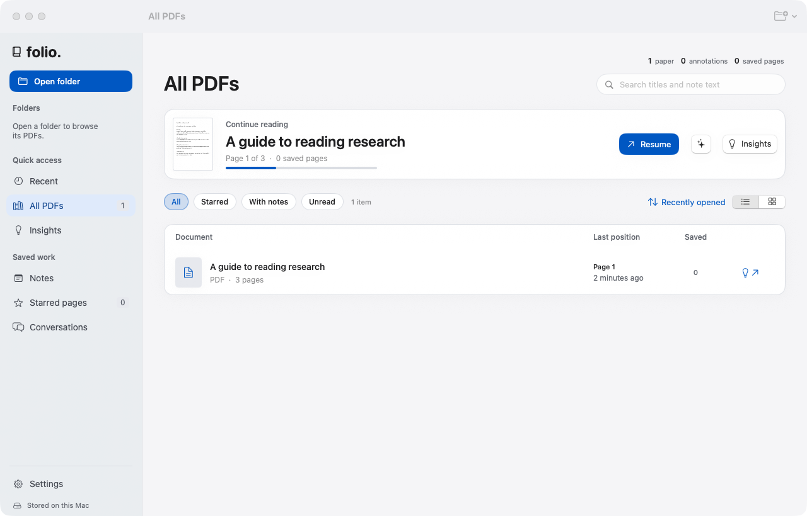
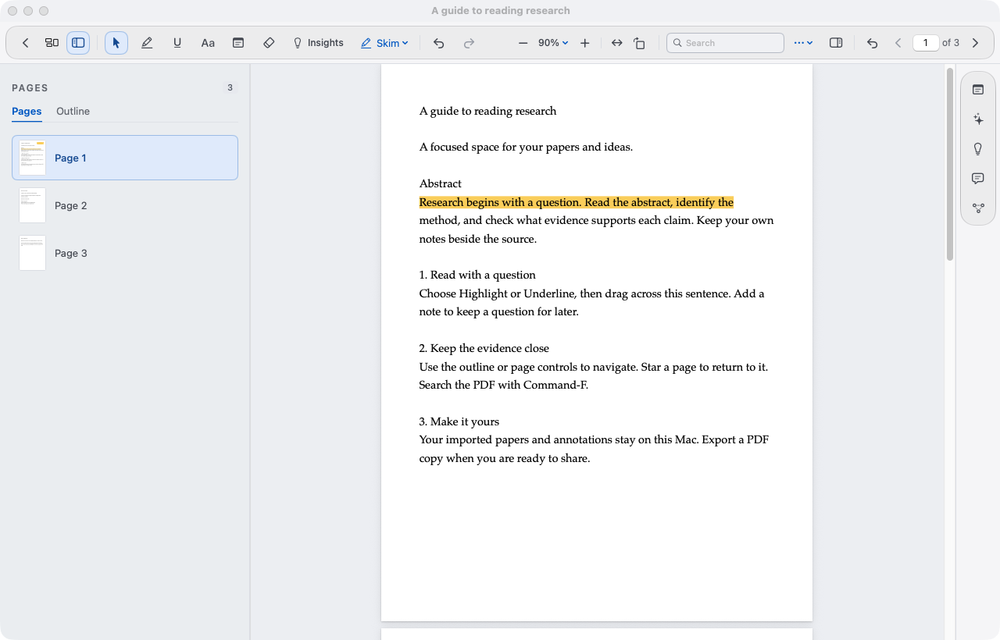
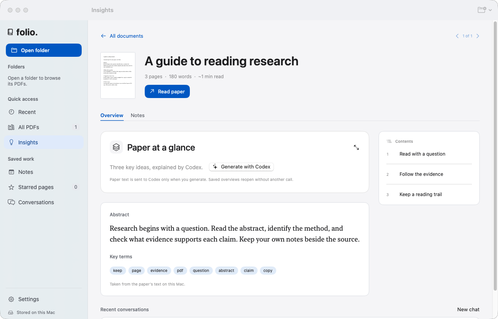

# Folio for Mac

**Read research papers, keep your thinking beside the source, and ask better questions.**

Folio is a native macOS research workspace built with SwiftUI, AppKit and PDFKit. It brings a local paper library, a capable PDF reader, written notes, study-copy exports and optional AI assistance into one application. It runs independently of a browser or web server, with no Folio account to create.

It is designed for students working through unfamiliar material, researchers comparing methods and evidence, and anyone who wants to return to a paper with their notes and reading position intact. The aim is to make close reading easier: move from the paper's overview to a passage, annotate it, ask a focused question and return to the evidence without juggling several tools.

## A look inside

The images below show the real application with its generated sample paper in a disposable library. No personal papers, credentials or conversations are included.


*Browse a local library and resume reading.*


*Read the source with native PDF navigation and annotation tools.*


*Inspect the paper before reading; generating an AI overview is a separate, explicit action.*

## Why use Folio?

| What you need | How Folio helps |
| --- | --- |
| Keep research organized | A searchable library, folders, list/grid layouts, sorting, stars and recent reading help you return to the right paper. |
| Read closely | Text search, page thumbnails, outlines, zoom, rotation and several page layouts keep the original PDF central. |
| Keep ideas attached to evidence | Highlights, underlines, written comments, text annotations and image attachments stay alongside the relevant material. |
| Understand difficult passages | Optional paper chat and selection explanations offer page citations and a choice of Codex CLI or Claude API. |
| Get oriented before a deep read | Insights collects the abstract, contents, notes and recent conversations; an optional generated overview separates Problem, Approach and Finding. |
| Study away from the app | Export a PDF copy, or a study copy with searchable continuation sheets for your page-specific writing. |
| Stay focused | A menu bar timer provides presets, pause/resume and a pull gesture for setting a reading session. |
| Keep control of your data | Reading and annotation work locally. You choose when to download papers, fetch reviews or send text to an AI provider. |

## What you can do

**Build a personal reading library.** Import PDFs with the open panel, drag and drop, or Finder's Open With. Download a paper from arXiv with an explicit action. Browse paper details, rename entries, copy titles, organize folders and filter by notes or starred pages. Recent reading resumes directly; opening a library paper first presents its Insights page.

**Read and annotate in one place.** Use single-page, continuous or two-page layouts, search within the document, follow its outline and return to your previous passage after a citation or page jump. Highlight or underline selected text in four colors, add written PDF notes and text, paste images, and use annotation Undo/Redo. Dark mode can dim the displayed PDF without changing its exported colors.

**Write beyond the margins.** The notes inspector groups written notes by page. Write Below This Page provides a compact editor for longer thinking, and ruled writing pages can be inserted into the managed document. Export Study Copy adds continuation sheets beside the corresponding source pages. Images attached to notes can travel with exported copies.

**Ask questions with the paper in view.** The reader's Ask panel supports multiple saved conversations, source/page links, Markdown, code and locally rendered mathematical notation. Claude API can stream answers; Codex CLI displays its answer on completion. Selection Insights mode explains a passage after you select it while that mode is enabled. Conversations searches saved local chats across papers and can resume an exact thread. AI answers can be mistaken: use citations to check the original text.

**Explore with explicit tools.** Paper at a glance generates source-backed Problem / Approach / Finding cards. Peer Reviews can retrieve OpenReview discussions and analyze cited concerns. Concept Map provides a graph view of extracted ideas. Optional local Skim uses an adapted MiniLM Core ML model to suggest Goal / Method / Result passages without a provider call; its labels are suggestions, not validated scientific judgments.

**Use familiar Mac controls.** Folio uses native windows, menus, keyboard shortcuts, system typography and a single Liquid Glass/material design with System, Light and Dark appearances. macOS 26 uses native glass; macOS 14/15 use material fallbacks. Reduce Transparency and Increase Contrast have solid-surface fallbacks.

## Install or build

Requires **macOS 14 or later**. Building from source also requires **Xcode 15.3 or later** with its command-line tools selected. There are no external Swift package dependencies. Node is not required to run Folio; it is only an optional way to install Codex CLI.

### If you have an application bundle

Copy `Folio.app` to your Applications folder and open it. Configure AI separately below, using your own accounts. Current local bundles are ad-hoc signed; Developer ID signing and notarization are not configured. Only run a bundle from a source you trust.

### Build from source

A fresh clone does **not** include the compiled local Skim model. Before packaging, supply the existing adapted checkpoint and follow [the model export instructions](Models/Skim/MODEL.md). The build script requires `Models/Skim/AdaptedMiniLM.mlmodelc`; it does not download weights automatically. Exporting the model requires the Python tooling listed in that guide. Source code and a Codex/Claude account alone are insufficient to reproduce the bundled model.

From this repository:

```sh
open Package.swift
```

Choose the **FolioMac** executable scheme in Xcode, or build the standalone app:

```sh
scripts/build-app.sh release
open .build/Folio.app
```

The standalone bundle keeps running after Terminal closes. [Development and verification](docs/DEVELOPMENT.md) covers local caches, generated sample data and tests.

## Configure Codex CLI

Codex CLI is Folio's default AI provider. Reading, notes and PDF export work without configuring AI.

1. Install the official CLI. With Homebrew:

   ```sh
   brew install --cask codex
   ```

   Alternatively, if Node/npm is already installed, use `npm install -g @openai/codex`. Choose one installation method. See [OpenAI's installation instructions](https://github.com/openai/codex#installing-and-running-codex-cli).

2. Sign in with **your own** account in Terminal and check the session:

   ```sh
   codex --version
   codex login
   codex login status
   ```

   Complete the browser sign-in. Account entitlements and usage limits apply. Folio uses the local CLI session and does not ship an account, login token or API key. See [Codex authentication](https://developers.openai.com/codex/auth/).

3. Reopen Folio, open a paper, show **Ask** and choose **Codex CLI** from the provider menu. Type a question and press Send. Folio currently requests **GPT-6.1 Terra with medium reasoning**; your account and CLI must support that model and Folio's CLI flags. Folio controls its own model/tool configuration rather than inheriting a project's Codex instructions.

Folio checks common Homebrew, local-bin and Codex app locations, then its launch `PATH`. If it cannot find your installation, launch the executable from Terminal with its path explicitly supplied:

```sh
FOLIO_CODEX_CLI="$(command -v codex)" .build/Folio.app/Contents/MacOS/FolioMac
```

For an installed bundle, replace the executable path with `/Applications/Folio.app/Contents/MacOS/FolioMac` (or its actual location). Quit any existing Folio instance first. Finder does not necessarily inherit your shell's environment. `FOLIO_CODEX_CLI` is a **launch-environment** setting, not a dotenv setting. Folio's packaged `FolioPaperTools` helper must stay inside the bundle.

## Configure Claude API

Claude API is optional and must be selected explicitly. It uses an API key from your own [Claude Console](https://platform.claude.com/settings/keys); API access and billing are separate from signing in to a consumer chat application. See [Anthropic's API setup](https://platform.claude.com/docs/en/api/overview).

1. Create an API key in the Console and arrange the API access/billing required by your account.
2. Create a private configuration file on **your Mac**, outside the application bundle:

   ```sh
   mkdir -p "$HOME/Library/Application Support/FolioMac"
   touch "$HOME/Library/Application Support/FolioMac/.env"
   chmod 600 "$HOME/Library/Application Support/FolioMac/.env"
   open -e "$HOME/Library/Application Support/FolioMac/.env"
   ```

3. In that file, add the following and replace the placeholder locally:

   ```dotenv
   ANTHROPIC_API_KEY=paste-your-own-key-here
   ```

   Save the file. Do not put the real key in the README, source code, a screenshot or a shared bundle. The configuration stays on this Mac.
4. Quit and reopen Folio. In an AI panel's header menu choose **Claude API**, then the available Claude model. The current default is **Claude Sonnet 5.5**; **Claude Opus 5.5** is also offered. Send a question to verify access. No request is made merely by choosing a provider or opening a paper.

For source development, the native repository's git-ignored `.env` is still a fallback. An `ANTHROPIC_API_KEY` supplied in Folio's launch environment takes precedence over file configuration. Existing locally imported Keychain keys remain supported. Settings intentionally has no key-entry form. Provider errors appear inline; Folio does not silently switch providers.

[The assistant setup guide](docs/AI_SETUP.md) explains configuration precedence, optional OpenReview authentication, data sharing and troubleshooting.

## Your first reading session

1. Import a disposable PDF with **⌘O**. Folio creates a managed copy; it does not edit the original file silently.
2. Review the paper's Insights page, then choose **Read** or **Resume**.
3. Select text and highlight or underline it. Use **⇧⌘N** for a written note, **⌘D** to star a page, and **⌘F** to search.
4. Open Ask for a paper question, or enable Selection Insights and select a passage to request an explanation. Ordinary text selection does not send a request.
5. Use **Export PDF Copy** (**⇧⌘S**) or **Export Study Copy** to share your work. Check important annotations in the recipient's PDF reader.

## Privacy and local data

The default library is `~/Library/Application Support/FolioMac/`. Managed PDFs live in `Documents/`; metadata, notes sidecars and saved AI conversations remain under the selected library root. Imported source PDFs remain separate. Removing a paper removes its managed copy, so export anything you want to keep first.

The app contains no bundled personal library, papers, chat history, account session or credential file. Build packaging maps local source/debug paths to generic prefixes and does not record the builder's home directory or dotenv location. A packaging check rejects home paths, private data files and recognized credential patterns before signing. Configuration is resolved for the user running the app. Existing libraries and local credentials on your own Mac are not deleted by these changes.

Reading, annotation and local Skim do not require an AI provider. Explicit Send, Generate, Explain, review lookup and arXiv download actions can use the network. **When Selection Insights is enabled, completing a selection requests an explanation.** AI requests share bounded extracted text and conversation context with the provider you choose; paper tools and web search may retrieve more evidence. Provider retention, account controls and charges follow that provider's policies. There is no Folio telemetry or background paper upload.

## Current limits

Folio is an actively developed native application. It does not yet offer cloud synchronization, collaborative libraries or migration of the web app's stored data. Scanned PDFs need OCR, which is not implemented. Arbitrary PDF export fidelity, very large-document performance and full accessibility coverage still need broader validation. Skim requires its separately supplied model and can misclassify sentences. Provider/model access depends on your account; automated checks do not guarantee live service availability.

See [feature coverage](docs/PORTING.md), [known limitations](docs/QUALITY.md), [model provenance](Models/Skim/MODEL.md) and [verification evidence](docs/TESTING.md).

## Development

This repository is an independent native application; the web app is not a runtime dependency. Start with [AGENTS.md](AGENTS.md), [the handoff](handoff.md) and [the context map](docs/README.md). Use `python3 scripts/context.py "annotations"` to find relevant owners and tests. Third-party resource provenance and licenses are described in [reference notes](docs/WEB_REFERENCE.md) and [model documentation](Models/Skim/MODEL.md).
